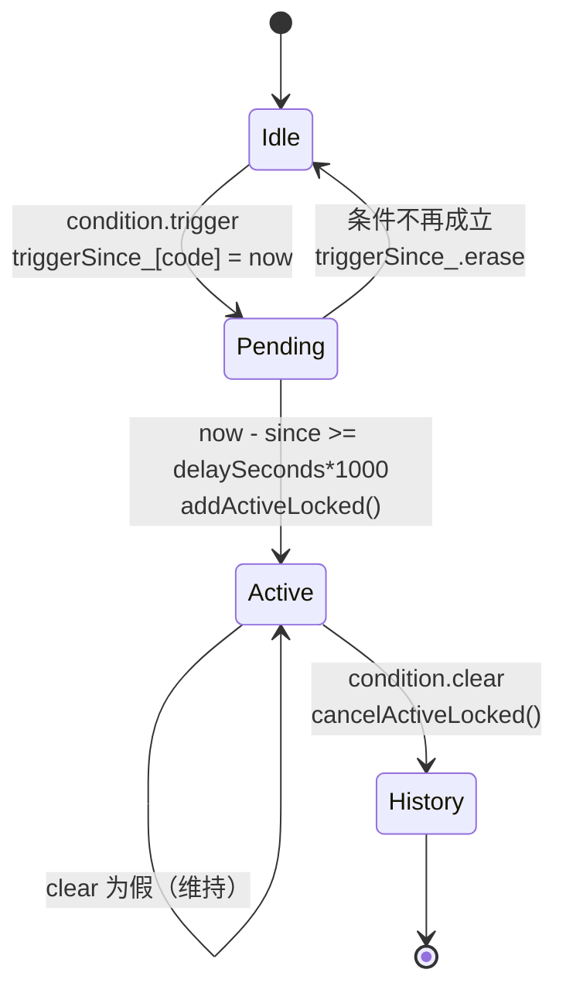

# 数据模型

27条阈值 

```
struct ThresholdEntry
{
    std::string_view code;
    std::string_view title;
    AlarmCategory category;
    std::string_view unit;
    std::string_view sensorA;
    std::string_view sensorB;
    std::string_view sensorC;
    bool hasLower = true;
    bool hasUpper = true;
    double defaultLower = 0.0;
    double defaultUpper = 0.0;
    double defaultHysteresis = 0.0;
};

vector<ThresholdEntry>
```

27条配置

```
struct ConfigurationEntry
{
    std::string_view code;
    std::string_view title;
    std::string_view category;
    std::string_view unit;
    std::string_view defaultText;
    std::string_view options;
    double defaultValue = 0.0;
    double minValue = 0.0;
    double maxValue = 0.0;
    bool numeric = false;
    bool readOnly = false;
};

vector<ConfigurationEntry>
```

118条告警 

```
struct AlarmEntry
{
    std::string_view code;
    std::string_view title;
    AlarmCategory category;
    AlarmSeverity severity;
    int delaySeconds;
    AlarmKind kind;
    std::string_view threshold;
    int member = 0;
    std::string_view dependsOn = "";
    bool enabled = true;
};

vector<AlarmEntry>
```

# 持久化

初版方案：/var/lib/phosphor-cdu/business.json

改版采用远端数据库方式。

# 心跳

```
constexpr int alarmTickIntervalMs = 1000;
```

# 采集与仲裁

阈值条目最多引用3个传感器，产生三种形态：

- 压差形态：值A-C，两个操作数都健康才有效

- 冗余对形态：

    坏一个：用好的那一个

    两个都坏：交给告警处理

    两个都好：取max，同时记录deviation|A-B|供“偏差过大“告警使用

- 单点形态：health[0]即有效

# 判定

从预定义的alarm列表中提取14种告警模式

```
enum class AlarmKind
{
    high,                  // value above the threshold upper limit
    low,                   // value below the threshold lower limit
    mismatch,              // redundant pair deviation above C201 / C301
    disconnection,         // sensor has no finite reading
    faultLow,              // boolean point reads 0   (e.g. Status_VFD1 = Failed)
    faultHigh,             // boolean point reads 1   (e.g. Sensor_L1 = Leak)
    noFlow,                // flow below T303 while the pump is commanded on
    pumpTimeout,           // pump commanded, no rotation
    abnormalWhileRunning,  // power / current / RPM below limit while commanded
    failover,              // designated pump faulted, standby did not take over
    valveFault,            // proportional valve does not follow its command
    allOf,                 // every code in dependsOn is active
    network,               // BMC / group link lost
    emergency,             // emergency stop asserted
};
```

每种alarm code的evaluation result即AlarmConfition

```
struct AlarmCondition
{
    bool trigger = false;
    bool clear = false;
    bool usable = true;  // false: state unknown, keep whatever we have
    double value = 0.0;
    std::string unit;
    double limit = 0.0;
    double deviation = 0.0;
    Json detail = Json::object();
};
```

上述AlarmCondition(trigger, clear, usable)中的usable用于判定传感器状态是否可用，没有读数不等于正常，有可能是断线等情况，确保不会因为读数消失而把已有告警静默清除。

|usable|含义|接下来的行为|
|true+trigger|确认越限|开始/继续累计延时|
|true+clear|确认恢复|取消告警，写入历史|
|false|状态未知|两个计时器都清零，活动状态保持原样|

# 告警状态机evaluate()



# LED灯/蜂鸣器/VFD/CDU停机recomputeActionLocked()

# 遥测意义不明确